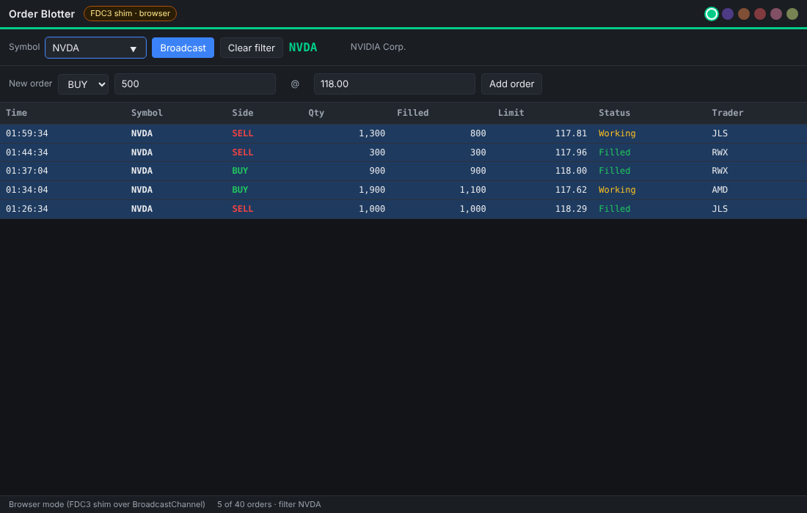
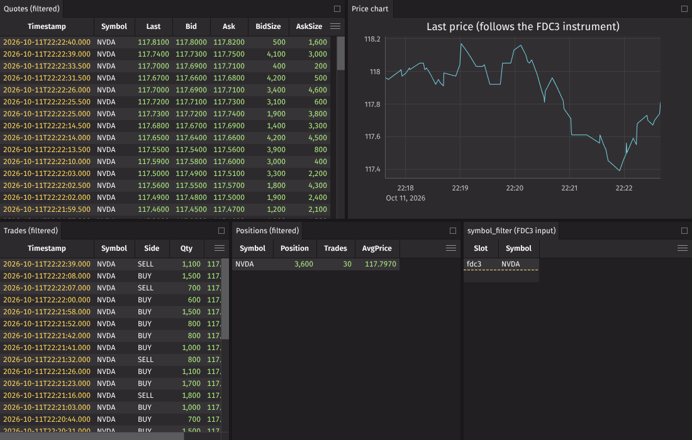
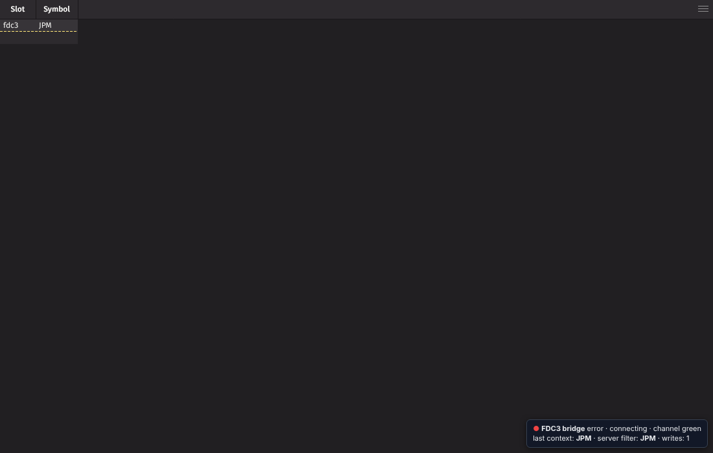
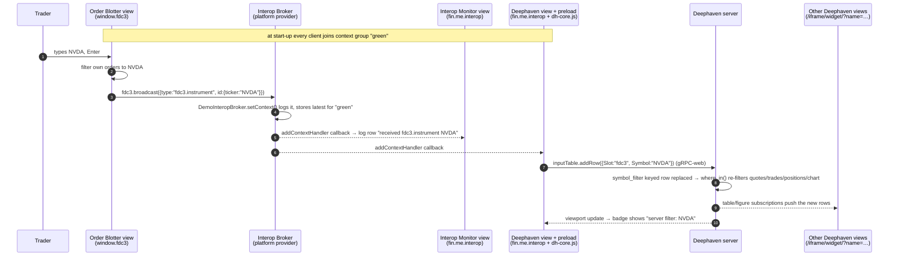

# Demo 01 · Interop API + FDC3 trading blotter — technical details

An equities **order blotter** (our own web app) runs inside a Here Core
platform next to several **Deephaven** panels (a third-party web UI we do not
control). When the trader types or clicks a symbol in the blotter, every panel
on the same colour channel re-filters to that symbol, including the Deephaven
tables and chart, which are filtered **server-side** by Deephaven.





## 1. The pieces

| Piece | Where | Role |
|-------|-------|------|
| Platform manifest | `public/manifest.fin.json` | Tells Here Core which runtime to use, which page is the provider, and the initial window layout (six views). |
| Platform provider | `platform/provider.html`, `src/platform/provider.ts` | Hidden window. Calls `fin.Platform.init()`, which creates the **Interop Broker**. Subclasses the broker to log every context. |
| Order blotter | `blotter/`, `src/blotter/` | Publisher. Uses the **FDC3 API** (`window.fdc3`) to join a user channel and `broadcast()` an `fdc3.instrument` context. Also listens so it follows other apps. |
| Interop monitor | `monitor/`, `src/monitor/` | Subscriber. Uses the **Interop API** (`fin.me.interop`) to receive the same contexts and shows them in a log. Proves FDC3 and the Interop API share one broker. |
| Deephaven bridge | `public/preload/deephaven-bridge.js` | **Preload script** injected by Here Core into one Deephaven view. Listens for `fdc3.instrument` with the Interop API and writes the symbol into a Deephaven **input table** with Deephaven's JS API. |
| Deephaven script | `deephaven/app.d/fdc3_blotter.py` | Defines simulated quotes/trades/positions, the `symbol_filter` input table and the `where_in`-filtered tables and chart that the layout embeds. |
| Deephaven views | manifest only | Plain views pointing at Deephaven's embed URL `http://localhost:10000/iframe/widget/?name=<table>`. No code of ours runs in them (except the bridge in one). |
| FDC3 shim | `src/shared/fdc3-shim.ts` | Browser-mode fallback so the pages work in plain Chrome for development and automated tests. Not used inside Here Core. |

## 2. Concepts

### 2.1 Platform, provider, views, layout

A Here Core *platform* is started from a manifest. The runtime opens the
`providerUrl` page in a hidden window; that page calls `fin.Platform.init()`
and becomes the **provider**, the process that owns window creation, snapshots
and the Interop Broker. The manifest's `snapshot.windows[].layout` describes
a tree of rows, columns and stacks whose leaves are *views*, each a Chromium
browser view with its own URL. Everything the user sees in this demo is a view
inside one platform window; the platform window itself uses Here Core's
default frame.

Relevant manifest fields:

```jsonc
{
  "runtime": { "version": "stable" },             // alias resolved to the current stable runtime
  "platform": {
    "uuid": "openfin-here-demo.interop-fdc3-blotter",
    "providerUrl": "http://localhost:5173/platform/provider.html",
    "defaultViewOptions": { "fdc3InteropApi": "2.0" }   // inject window.fdc3 (FDC3 2.0) into every view
  },
  "snapshot": { "windows": [ { "layout": { "content": [ /* rows/columns/stacks/components */ ] } } ] }
}
```

`fdc3InteropApi: "2.0"` is the single switch that makes `window.fdc3` exist in
a view. Because it is set in `defaultViewOptions` it applies to the Deephaven
views as well, though the bridge uses the lower-level Interop API instead.

### 2.2 The Interop Broker, context groups and user channels

`fin.Platform.init()` creates one **Interop Broker** per platform. Every view
in the platform gets an **Interop Client** pre-connected to it, exposed as
`fin.me.interop`. The broker keeps a set of **context groups**: by default
`green`, `purple`, `orange`, `red`, `pink`, `yellow`. A client joins a group
(`joinContextGroup('green')`), after which `setContext(ctx)` is delivered to
every other client in that group that registered `addContextHandler()`, and
the broker remembers the latest context per group so late joiners receive it
immediately.

FDC3 **user channels** are the same groups seen through the FDC3 API:
`fdc3.joinUserChannel('green')` and `fdc3.broadcast(ctx)` map onto
`joinContextGroup` and `setContext`. That is why the blotter (FDC3) and the
monitor (Interop API) interoperate without any adapter code.

| Operation | FDC3 API (`window.fdc3`) | Interop API (`fin.me.interop`) |
|-----------|--------------------------|--------------------------------|
| Join a colour channel | `joinUserChannel('green')` | `joinContextGroup('green')` |
| List channels | `getUserChannels()` | `getContextGroups()` |
| Send context | `broadcast(ctx)` | `setContext(ctx)` |
| Receive context | `addContextListener('fdc3.instrument', h)` | `addContextHandler(h, 'fdc3.instrument')` |
| Latest context | `getCurrentChannel().getCurrentContext()` | `getCurrentContext('fdc3.instrument')` |
| Move *another* view into a group | — | `joinContextGroup('red', { uuid, name })` (platform-level control) |

The provider can customise the broker with `interopOverride` (see
`src/platform/provider.ts`). This demo only logs `setContext`; the same hook
is where you would implement intent resolution (`handleFiredIntent`),
connection authorisation (`isConnectionAuthorized`) or custom channel
metadata (`getContextGroups`).

### 2.3 The `fdc3.instrument` context

The blotter broadcasts the FDC3 standard instrument context:

```json
{ "type": "fdc3.instrument", "name": "NVIDIA Corp.", "id": { "ticker": "NVDA", "BBG": "NVDA US Equity" } }
```

Receivers (`src/shared/instruments.ts`, and the same logic duplicated in the
preload script) read `id.ticker`, falling back to the Bloomberg code and then
a RIC, so contexts broadcast by other vendors' apps still resolve.

### 2.4 Preload scripts: making a third-party page interop-aware

A view (or window) option `preloadScripts: [{ url }]` makes Here Core fetch a
script and run it in the page's JavaScript context *before* the page's own
scripts, with `fin` already injected. The script therefore:

- runs on the **Deephaven origin** (`http://localhost:10000`), so it can load
  Deephaven's JS API from `/jsapi/dh-core.js` and open the gRPC-web connection
  without any cross-origin concerns;
- can use `fin.me.interop` (and `window.fdc3`) like any other view;
- can decorate the page: the bridge adds a small status badge in the corner.



Preload scripts are *classic* scripts, so the bridge is written without
`import` statements; it uses dynamic `import()` for the Deephaven module. Only
the `symbol_filter` view carries the preload (see the manifest); giving it to
every Deephaven view would work but would write the same row several times.

### 2.5 Deephaven: embed widgets, JS API, input tables and `where_in`

- **Embed URL.** Deephaven serves any table, figure or deephaven.ui widget in a
  chrome-less page at `/iframe/widget/?name=<variable>`. The OpenFin layout
  simply points views at those URLs. The full IDE is at `/ide/`.
- **JS API.** The same server serves its client library at `/jsapi/dh-core.js`
  (an ES module). The bridge uses: `new dh.CoreClient(url)` →
  `login({type: LOGIN_TYPE_ANONYMOUS})` → `getAsIdeConnection()` →
  `subscribeToFieldUpdates()` to find the `symbol_filter` variable →
  `getObject()` → `table.inputTable()` → `addRow({Slot, Symbol})`. It also
  subscribes to the table (`setViewport` + `EVENT_UPDATED`) to show the value
  the server holds.
- **Input table.** `input_table(col_defs={"Slot": string, "Symbol": string}, key_cols="Slot")`
  is a *keyed* in-memory table that clients may write to. Because it is keyed
  on `Slot`, re-adding `{Slot: "fdc3", Symbol: "MSFT"}` replaces the previous
  row, so there is always exactly one selected symbol per slot.
- **Dynamic filter.** `quotes.where_in(symbol_filter, "Symbol")` produces a
  table that is re-evaluated incrementally whenever *either* side changes.
  Five derived objects (`quotes_filtered`, `trades_filtered`,
  `positions_filtered`, `instrument_filtered`, `price_chart`) all hang off the
  same filter table, so **one row write updates every panel**, on the server,
  with no per-panel client code. Adding a sixth filtered panel is one line of
  Python and one view in the manifest.
- **Loading the script.** Docker uses *application mode*
  (`-Ddeephaven.application.dir=/app.d`, `fdc3_blotter.app` lists the script);
  the pip path runs an *embedded server* (`run_server.py`) and executes the
  script in the Python `__main__` scope. Both make the variables visible to the
  web UI and the JS API under the same names.
- **Authentication.** The demo starts Deephaven with
  `-DAuthHandlers=io.deephaven.auth.AnonymousAuthenticationHandler` so the embed
  pages and the bridge need no token. For a real deployment use PSK or an SSO
  handler and pass the credentials in the bridge configuration (`psk`) or via
  Deephaven's `authProvider=parent` iframe flow.
- **CORS.** Deephaven answers `Access-Control-Allow-Origin` for the requesting
  origin, which is what lets the *browser-mode* bridge page on `localhost:5173`
  use the JS API. Inside Here Core this is moot because the preload runs on
  the Deephaven origin.

## 3. End-to-end flow



In the automated browser-mode run the whole chain, from `broadcast()` to the
Deephaven table showing only the new symbol, completed in well under a second.

## 4. Code walk-through

### `src/platform/provider.ts`

```ts
await fin.Platform.init({
  interopOverride: async (InteropBroker) => {
    class DemoInteropBroker extends InteropBroker {
      override setContext(payload, clientIdentity) {
        console.log('[interop-broker] setContext', payload.context, 'from', clientIdentity.name);
        super.setContext(payload, clientIdentity);
      }
    }
    return new DemoInteropBroker();
  },
});
```

### `src/blotter/main.ts` (publisher, FDC3)

```ts
const { fdc3 } = await getFdc3();                       // window.fdc3, or the shim in a plain browser
await fdc3.joinUserChannel('green');
await fdc3.addContextListener('fdc3.instrument', ctx => applySymbol(symbolFromContext(ctx)));
// on user action:
await fdc3.broadcast(instrumentContext('NVDA'));
```

`src/shared/bus.ts` wraps this in a `ContextBus` so the channel picker and the
log component can be shared with the monitor.

### `src/monitor/main.ts` (subscriber, Interop API)

```ts
const interop = fin.me.interop;                          // Interop Client, already connected to the broker
await interop.joinContextGroup('green');
await interop.addContextHandler(ctx => log(ctx));        // no type filter: every context
// quick-broadcast buttons:
await interop.setContext(instrumentContext('AAPL'));
```

### `public/preload/deephaven-bridge.js` (Deephaven side of the link)

```js
// transport (inside Here Core)
await fin.me.interop.joinContextGroup(config.channel);
await fin.me.interop.addContextHandler(onContext, 'fdc3.instrument');

// Deephaven
const dh = (await import(config.serverUrl + '/jsapi/dh-core.js')).default;
const client = new dh.CoreClient(config.serverUrl);
await client.login({ type: dh.CoreClient.LOGIN_TYPE_ANONYMOUS });
const connection = await client.getAsIdeConnection();
const definition = await findVariable(connection, 'symbol_filter');   // via subscribeToFieldUpdates
const table = await connection.getObject(definition);
const inputTable = await table.inputTable();

// per context (serialised through a promise queue so writes stay ordered)
await inputTable.addRow({ Slot: 'fdc3', Symbol: 'NVDA' });
```

The script exposes `window.__dhFdc3Bridge` (`getState()`, `setSymbol()`,
`setChannel()`, `onChange()`) for debugging from DevTools and for tests.

### `deephaven/app.d/fdc3_blotter.py`

```python
symbol_filter = input_table(col_defs={"Slot": dht.string, "Symbol": dht.string}, key_cols="Slot")
quotes_filtered    = quotes.where_in(symbol_filter, "Symbol").reverse()
trades_filtered    = trades.where_in(symbol_filter, "Symbol").reverse()
positions_filtered = positions.where_in(symbol_filter, "Symbol")
price_chart = Figure().plot_xy(series_name="Last", t=quotes.where_in(symbol_filter, "Symbol"), x="Timestamp", y="Last").show()
```

## 5. Design decisions

| Decision | Why | Alternative considered |
|----------|-----|------------------------|
| Filter in Deephaven via an input table + `where_in` | One write fans out to N panels server-side; the Deephaven views stay stock embeds with zero custom code; works for tables *and* figures. | Driving each Deephaven grid's client-side quick filter through its JS API. Needs per-panel code, does not cover charts, fights the UI's own state. |
| Bridge as a **preload script** on one Deephaven view | Same origin as Deephaven (no CORS, no auth juggling), demonstrates a Here Core feature that is unique to the container, no wrapper page to maintain. | A wrapper page of ours embedding Deephaven in an iframe. Works (it is what browser mode does) but adds a layer and relies on CORS. |
| Blotter uses FDC3, monitor uses the Interop API | Shows both APIs against the same broker in one screen, which is the question people ask most. | Everything via FDC3 only. |
| Keyed input table with a `Slot` column | Replace-on-write semantics keep exactly one row per slot; extra slots (per channel, per user) are free. | Append-only table + `last_by`. More rows, more code. |
| `runtime.version: "stable"` | Always a current runtime, no stale pin in the repo. Pin an explicit `x.y.z` for reproducible demos. | Hard-coded version. |
| Browser-mode shim over `BroadcastChannel` | Lets the UI be developed and tested in plain Chromium and in CI; the live Deephaven round trip is covered by a Playwright test. | No fallback; everything manual. |
| Vite multi-page app, no UI framework | Each view is a tiny page; the point is the interop code, not the UI stack. | React/Angular. |

## 6. Security notes (demo-only shortcuts)

- Deephaven runs with anonymous auth and CORS open; both are for local use only.
- `licenseKey` in the manifest is the public demo key; production platforms need a Here license.
- Preload scripts execute with full access to the page: serve them from a trusted origin over HTTPS in anything beyond a demo.
- The platform allows any content to connect to the broker; restrict with `isConnectionAuthorized` in the broker override.

## 7. Troubleshooting

| Symptom | Likely cause | Fix |
|---------|--------------|-----|
| Deephaven views show "Unable to load" or a login screen | Server not running, wrong port, or not started with anonymous auth | `curl http://localhost:10000/ide/`; check `START_OPTS` / `run_server.py` auth flag |
| Bridge badge says `Deephaven table "symbol_filter" not found` | Script not loaded (Docker: `app.d` not mounted; pip: `run_server.py` not used) | Open `/ide/`, check the Panels menu lists `symbol_filter` |
| Blotter badge says "FDC3 shim · browser" inside Here Core | `fdc3InteropApi` missing from the view options | Keep `platform.defaultViewOptions.fdc3InteropApi = "2.0"` |
| Monitor receives nothing | Different colour channels | Click the same colour dot in both panels |
| Edits to `deephaven-bridge.js` not picked up | Here Core caches preload scripts | Close the platform fully and relaunch; or bump a query string on the preload URL |
| Nothing opens on launch | Dev server not on 5173, or manifest URL typo | `curl http://localhost:5173/manifest.fin.json` |

## 8. Where to go next

- **Intents:** raise `ViewChart` from the blotter and resolve it in the broker override to focus the chart view.
- **Multi-select:** broadcast `fdc3.instrumentList`; write several rows (one slot each) so Deephaven shows a basket.
- **Reverse direction:** subscribe to a Deephaven alerts table in the bridge and broadcast contexts *into* the platform.
- **Per-channel slots:** key the input table on the colour channel so red and green desks filter independently.
- **Workspace:** register the blotter in Here Workspace (Home/Store/Dock) and add notifications on fills.
