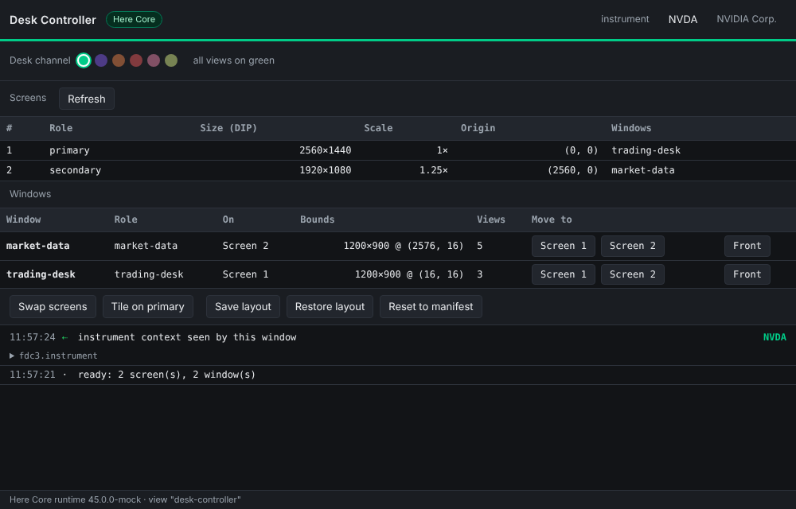
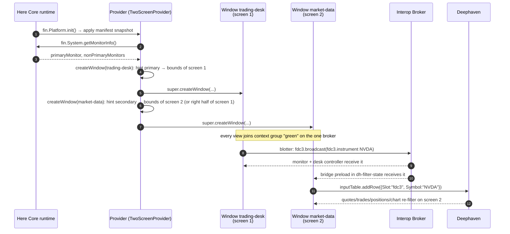

# Demo 02 · Two windows on two screens, one Interop Broker — technical details

Demo 01 put the whole desk in one platform window. Demo 02 splits it into
**two platform windows** so they can live on two monitors:

| Window | Screen hint | Contents |
|--------|-------------|----------|
| `trading-desk` | primary | Order Blotter, **Desk Controller** (new), Interop Monitor |
| `market-data` | secondary | Deephaven quotes, price chart, trades, positions, `symbol_filter` (bridge host) |

Pick a symbol in the blotter on screen 1 and the Deephaven panels on screen 2
follow, exactly as in demo 01. The Deephaven tables are the ones from demo 01
(`shared/deephaven/`), unchanged.



## 1. Why the two windows stay in sync with no extra code

In Here Core a **platform** owns the Interop Broker; windows are only
containers for views. Every view, in any window of the platform, gets an
Interop Client (`fin.me.interop`) connected to that one broker, and the FDC3
API in each view sits on top of that client. Context groups ("colour
channels") are therefore **platform-wide**: a view in the `trading-desk`
window on channel green and a view in the `market-data` window on channel
green are in the same group.

So the blotter, the monitor and the Deephaven bridge are byte-for-byte the
same code as in demo 01 (they come from the shared `trading-panels` package).
Nothing in them knows which window it runs in. The only things that changed
between the demos are the manifest (two windows) and the provider (window
placement).

What *would* need extra code: two **separate platforms** (two manifests, two
`platform.uuid`s). Each would have its own broker, and you would bridge them
with `fin.Interop.connectSync(otherPlatformUuid)` or run both inside Here
Workspace, whose browser owns one broker for every app it hosts. That is a
good follow-up demo; it is not needed for "two windows on two screens".

## 2. Getting each window onto the right screen

### 2.1 The hint in the manifest

Each window in the manifest snapshot carries a hint in `customData`:

```jsonc
{ "name": "market-data",
  "customData": { "role": "market-data", "screen": "secondary", "tileWhenSingle": "right" },
  "saveWindowState": false,
  "layout": { /* Deephaven views */ } }
```

- `screen`: `"primary"`, `"secondary"` (the first monitor to the right of the primary, else any other) or a 1-based screen number.
- `tileWhenSingle`: on a single-monitor machine (a laptop on the train) there is no second screen, so the two desk windows take the `left` and `right` halves of the primary instead of overlapping.
- `autoPlace: false` (set by the Desk Controller in saved layouts): keep the stored bounds, do not re-place.
- `saveWindowState: false` so Here Core does not restore last-session bounds over the hint.

### 2.2 The provider override

`fin.Platform.init({ overrideCallback })` lets the provider subclass the
Platform Provider. Demo 02 overrides `createWindow()`, which the runtime calls
for every window in the manifest snapshot, for `platform.createWindow()` and
for `platform.applySnapshot()`:

```ts
class TwoScreenProvider extends Provider {
  override async createWindow(options, identity) {
    const hint = readScreenHint(options.customData);
    if (hint && hint.autoPlace !== false) {
      const info = await fin.System.getMonitorInfo();
      const placed = placeWindow(info, hint);            // pure function, unit-tested
      Object.assign(options, { defaultLeft: placed.bounds.left, defaultTop: placed.bounds.top,
                               defaultWidth: placed.bounds.width, defaultHeight: placed.bounds.height,
                               defaultCentered: false, saveWindowState: false });
    }
    return super.createWindow(options, identity);
  }
}
```

### 2.3 What `fin.System.getMonitorInfo()` returns

```ts
{
  primaryMonitor:    { name, deviceId, deviceScaleFactor, monitorRect, availableRect, ... },
  nonPrimaryMonitors: [ /* same shape */ ],
  virtualScreen:     { left, top, right, bottom },   // bounding box of all monitors
  deviceScaleFactor, dpi, taskbar, reason
}
```

- Coordinates are **DIP** (device-independent pixels) in one virtual screen. The primary monitor's top-left is `(0,0)`; a monitor to the left of it has a negative `left`. Window bounds (`defaultLeft`, `setBounds()`, `getBounds()`) use the same space, which is what makes placement a matter of copying rectangles.
- `monitorRect` is the whole panel; `availableRect` excludes the Windows taskbar or the macOS menu bar and Dock. The demo uses `availableRect`.
- `deviceScaleFactor` differs per monitor (Windows per-monitor DPI, Retina on macOS). Because DIP already accounts for it, the demo never multiplies by it; it only displays it.
- The runtime fires `monitor-info-changed` on `fin.System` when a display is plugged in or rearranged; the Desk Controller refreshes on it.

`src/platform/placement.ts` holds the rules (`listScreens`, `pickScreen`,
`boundsOn`, `placeWindow`, `screenOf`) with no `fin` dependency, so they are
covered by unit tests for single, dual, left-of-primary and triple-monitor
layouts.

## 3. The Desk Controller

A new panel in the `trading-desk` window that shows the desk and lets you
manage it from inside the platform. Each action maps to one API:

| Action | API |
|--------|-----|
| List screens | `fin.System.getMonitorInfo()`, `fin.System.on('monitor-info-changed')` |
| List windows, which screen each is on, its views | `fin.Application.getCurrentSync().getChildWindows()`, `Window.getOptions()` (`customData.role`), `Window.getBounds()`, `Window.getCurrentViews()` |
| Move a window to screen N / Swap / Tile | `Window.setBounds(boundsOn(screen, slot))`, `Window.bringToFront()` |
| Re-open a closed desk window | `fetch('/manifest.fin.json')` → `platform.createWindow(windowDefinition)` (the provider override places it) |
| Save layout | `platform.getSnapshot()` → stamp `customData.autoPlace = false` → `localStorage` |
| Restore layout / Reset to manifest | `platform.applySnapshot(snapshot, { closeExistingWindows: true })` |
| Desk channel | `fin.me.interop.joinContextGroup(channelId, viewIdentity)` for every view of every window |
| Instrument sync status | `fdc3.addContextListener('fdc3.instrument', …)` |

The **desk channel** is worth a closer look. `joinContextGroup` takes an
optional *target identity*; without it the caller joins, with it the caller
moves another entity. "Every Interop Client at the given identity" is moved,
which includes the Deephaven bridge preload's client in the `dh-filter-state`
view. One click therefore re-channels eight views across two windows, no
message passing required. In browser mode this is a per-tab action only.

Snapshots capture window bounds, so "Save layout" is how a trader keeps
"market data on my left screen, maximised" between sessions. The provider's
placement logic is skipped for restored windows because the saved snapshot
carries `autoPlace: false`.

## 4. Start-up and symbol flow



## 5. Design decisions

| Decision | Why | Alternative |
|----------|-----|-------------|
| Two windows in **one** platform | Shared broker gives cross-window sync for free; one manifest; one launch. | Two platforms bridged with `fin.Interop.connectSync` — more moving parts, worth its own demo. |
| Placement in the provider's `createWindow` override | Runs for the manifest snapshot, `createWindow()` and `applySnapshot()` alike; windows appear directly on the right screen, no visible jump. | Place after the fact with `setBounds()` from a view: works (the Desk Controller does it on demand) but the window flashes on the wrong screen first. |
| Hint in `customData`, not computed from the window name | Declarative, visible in the manifest, survives tear-outs and snapshots. | Hard-coding names in the provider. |
| Pure `placement.ts` | Unit-testable monitor maths without a runtime. | Inline in the provider. |
| Tile on single monitor | A laptop demo should still show both windows without overlap. | Stack windows and let the user sort it out. |
| Shared `trading-panels` package | Demo 02 reuses the blotter, monitor, bridge and shim unchanged; fixes land in both demos. | Copying demo 01's files. |

## 6. Troubleshooting

| Symptom | Likely cause | Fix |
|---------|--------------|-----|
| Both windows open on the same screen although two are connected | The OS reports one display (mirroring on), or the second display is *above/below* the primary and not to its right | Set the displays to *extend*; the Desk Controller's "Move to Screen 2" works regardless of arrangement |
| Windows open on the right screens but keep the previous session's bounds | `saveWindowState` left at `true` somewhere | The manifest sets it to `false` per window and in `defaultWindowOptions` |
| Screen numbers in the Desk Controller do not match the OS's numbers | The demo numbers screens left to right; Windows/macOS number by connection order | Use the "primary" label and the origin coordinates to tell them apart |
| Restored layout puts a window off-screen | The layout was saved with a monitor that is no longer connected | "Reset to manifest" or move it with "→ Screen 1" |
| Text looks blurry on one screen | Different `deviceScaleFactor` per monitor | Expected on mixed-DPI set-ups; Chromium re-rasterises when the window crosses over |
| Desk channel click does nothing for Deephaven | The bridge view was closed | Re-open `market-data` from the manifest |

## 7. Where to go next

- Put the Desk Controller into a **custom window frame** (`defaultWindowOptions.url`) so the channel picker lives in each window's title bar.
- **Two platforms**: run `trading-desk` and `market-data` as separate platforms and bridge their brokers.
- **Here Workspace**: the Workspace Browser already provides tabbed windows per screen, saved pages and a channel picker; register the panels as Workspace apps instead of hand-building the window logic.
- Persist layouts server-side (per user) instead of `localStorage`.
